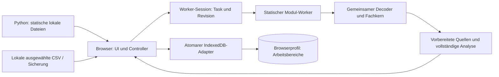

# Architektur und Projektkarte

Stand: 2026-10-04. Die aktive Anwendung läuft im Browser am festen Loopback-
Origin `http://127.0.0.1:8765`. Python liefert lokale, ausdrücklich erlaubte
Anwendungsdateien mit seiner Standardbibliothek. CSV-Import, Aufbereitung,
Fachanalyse und IndexedDB-Speicherung bleiben im Browser. Der Server besitzt
keine Workspace-Datenbank, Uploadschnittstelle oder Backend-Daten-API.

## Aktuelle Modulgrenzen

| Dateien | Verantwortung |
| --- | --- |
| `index.html`, `app.css`, `terminal-theme.css` | Anwendungshülle und lokale Stile |
| `app.js` | Deutsch/englische UI, Navigation, Importsteuerung, Ansichten, Workerkoordination und Workspace-Lifecycle |
| `src/application/workspace-preparation.js` | Direkt exportierte Dekodier-/Profil-, Workspace-Vorbereitungs-, Neuanalyse- und Restore-Vorgänge; benutzt dieselben Fachmodule wie der Controller-Fallback |
| `src/application/worker-session.js` | Ein sequentieller Hintergrundtask, Workerwiederverwendung, Task-ID, Revisionsprüfung, Fortschritt, Abbruch, Timeout und Leerlauffreigabe |
| `src/workers/workspace-worker.mjs` | Statischer lokaler Modul-Worker; importiert die vorhandenen Fachmodule und startet den gemeinsamen Taskhandler |
| `src/ui/shared/windowed-dom.js` | Begrenzte Wiederverwendung sichtbarer Tabellenzeilen und geordneter DOM-Abgleich mit Fokusbehandlung |
| `runtime.js` | Loopback-Erkennung, Startgrenzen und optionale Browserfähigkeiten |
| `encoding.js`, `csv.js` | Decoder, Streaming-CSV, Mapping, Regeln, Profile, Validierung, Artikelregister und vollständige exakte Analyse |
| `periods.js`, `terminal.js` | Abdeckung und Periodenvergleich; begrenzter Datumsindex; Analyseschreibtisch, Ranglisten und Locale-Suchprojektionen |
| `workspace.js`, `storage.js` | Workspace-/Sicherungsvertrag, Validierung/Migration, stapelsichere Base64-Prüfung und atomare Chunk-Speicherung in IndexedDB |
| `warehouse.js` | Layoutvalidierung, stabile IDs, Teilcodes, Artikelzuordnung und geometrische Kollisionsprüfung |
| `warehouse-scene.js`, `warehouse-webgl.js` | Gemeinsame Szene, CPU-Projektion, Framepuffer und lokales WebGL2-Rendering |
| `warehouse-editor.js`, `warehouse-editor.css` | Layoutbearbeitung, bestätigtes Speichern, Sperren, 20-stufige Undo/Redo-Historie und Draufsicht/3D |
| `warehouse-analysis.js` | Lesende Stellplatz-/Artikelstammanalyse; verändert keine gespeicherten Layouts |
| `Start-OpenSlotting-Localhost.py` | Statischer Loopback-Dienst, Launcheridentität und begrenzter Cache erlaubter Runtime-Assets mit ETag-Revalidierung |
| `OpenSlotting.Windows.psm1` | Edge-Erkennung und sichere verwaltete Verknüpfungen |
| `OpenSlotting.Localhost.Windows.psm1` | Python-Erkennung, geprüfte Serverownership, Start/Stop und Localhost-Verknüpfungen |

Die neuen Anwendungsmodule bilden eine erste gezielte Trennung von `app.js`.
Die übrigen Fachmodule liegen weiterhin an ihren bekannten Orten. Es gibt
keinen Bundler, Framework-Build oder vollständigen Dateiumzug.

## Verarbeitungs- und Speicherweg

Der Worker profiliert Dateien, bereitet Arbeitsbereiche vor, führt Neuanalysen
aus und validiert/serialisiert Sicherungen. Er verwendet die vorhandenen
Fachkerne und gibt deren vollständige Ergebnisse zurück. Der Controller nutzt
eine bereits berechnete Analyse, statt sie nach Workerabschluss noch einmal
vollständig zu bilden. Browser ohne verfügbare Worker behalten den lokalen
Fallback über dieselben exportierten Funktionen.

Eine Session hält höchstens einen Task. Task-ID und Eingaberevision verhindern,
dass eine verspätete Antwort einen neueren Vorgang abschließt. Erfolg erlaubt
Wiederverwendung; 30 Sekunden Leerlauf geben den Worker frei. Abbruch, Fehler,
Verlassen der Seite und fünf Minuten ohne Antwort beenden ihn. Workspace-/Sprach-
und Dateiauswahlwechsel werden zusätzlich am Anwendungsvorgang geprüft.
Die Session ersetzt keine Speichertransaktion: Erst deren Bestätigung stellt
einen erfolgreichen Commit dar.

Bei geeigneten Ladevorgängen werden ArrayBuffer übertragen und anschließend
zurückgegeben. Profilierung und Neuanalyse erzeugen vorher eine Kopie der
Quellbuffer, damit Abbruch oder ein Workerfehler die weiterhin sichtbaren
Originalquellen nicht durch Transfer entziehen. Diese Schutzkopie hat Kosten;
die Architektur behauptet keine durchgehend kopierfreie Importstrecke.
Vollständig dekodierter Text und geparste Rohzeilen werden nach Vorbereitung
nicht als zweite dauerhafte Quelle gehalten. Originalbytes bleiben erhalten.

## Verträge für Analyse und Caches

| Cache / Optimierung | Eingabe und Lebensdauer | Unveränderter Fachvertrag |
| --- | --- | --- |
| Periodenindex | Private WeakMap am Zeilenarray; ausdrückliche `indexRevision`; neue Revision/Länge oder Invalidierung ersetzt den Index | Originalpositionen und vollständiger Kern; Mengen als BigInt, genaue Umsätze, Readiness, Register, Distinct-Metriken und Überschneidungen |
| Terminal-Suchtexte | Private WeakMap an Entitätsobjekten; aktuelle `label`-/`secondary`-Werte und Sprache prüfen | Trim + Locale-Lowercase + Substring; vorhandene Rang-/Ein-Abfrage-Viewcaches und zusammengesetzte Auftragsidentität |
| Sichtbare Tabellenzeilen | Nur aktuelles Fenster; Quellen-/Ansichtsidentität sowie Sprache, Spalten, Regeln und Ergebnisversion in der Darstellungssignatur | Gleiche Zellwerte, Originalquellen, Reihenfolge, Pagination und Virtualisierung |
| Lagergeometrie | Vorberechnung je Kollisionsprüfung bzw. innerhalb eines Renderframes | Gleiche SAT-Arithmetik, 0,001-mm-Kontaktgrenze, Paarreihenfolge, Picking und Float32-Ausgabe |
| HTTP-Assets | Ausschließlich erlaubte Runtime-Dateien; Dateistatistik invalidiert den Cache, Inhalt bestimmt ETag | HTML `no-store`; sonst Revalidierung mit `no-cache`/304; keine Workspace- oder Nutzerdateien im Servercache |

Der Periodenindex beginnt erst ab dem zweiten ausdrücklich revisionierten
Vergleich, bei 512 bis 250.000 Zeilen und höchstens 4.096 Datumsschlüsseln.
Mehr als 50 % ausgewählte Kandidaten nutzen den Scan. Der Index hält flache
Zeilenreferenzen/Offsets statt Zeilensnapshots oder Entitätssichten. Bei
Änderungen von Lieferdatum oder Zeilenreihenfolge am selben Array muss der
Aufrufer eine neue Revision setzen oder `invalidateComparisonIndex` verwenden;
die Anwendung erzeugt neue Analyseergebnisse. Mengen, Namen und Registrywerte
werden durch den Index nicht zwischengespeichert.

Fehlendes Lieferdatum gehört zu keinem gewählten Zeitraum. Fehlende Exporttage
belegen weiterhin keinen Nullbedarf. Distinct-Kunden-/Auftragszahlen sind
nicht additiv; Prefixsummen eines engen Labor-Mengenkerns ersetzen deshalb
keine vollständige Analyse. Lagergrenzen bleiben 150 Objekte und 5.000
Stellplätze. Editorhistorie, Sperren, Codes und bestätigtes Speichern behalten
ihre bestehenden Regeln.

## Datenschutz, Laufzeit und Datenkompatibilität

IndexedDB bleibt im aktuellen Browserprofil und Origin: Datenbank
`openslotting-workspaces`, Datenbankversion 3, Workspace-Schema 13. Neue
Module und flüchtige Caches erfordern keine Datenmigration und verändern den
Sicherungsvertrag nicht. Originalbytes und BigInt-/Binärkodierung bleiben
verlustlos. Die Base64-Korrektur vermeidet die rekursiv gruppierte Prüfung
großer Sicherungen bei gleichem akzeptiertem Format.

Die normalen Benutzerbefehle heißen `Start-OpenSlotting.cmd`,
`Stop-OpenSlotting.cmd`, `Install-OpenSlotting.cmd` und `Remove-OpenSlotting.cmd`.
Vorhandene `*-Localhost`-Namen bleiben kompatible Einstiegspunkte mit demselben
Server und Datenorigin. Python 3.8 oder neuer bleibt die einzige zusätzliche
Nutzerabhängigkeit. Vorhandener Browser, Windows-PowerShell und der vollständige
lokale Ordner genügen; keine npm-/pip-Pakete, OpenSlotting-EXE oder Cloudkonten.
Node.js ist nur ein Entwicklungswerkzeug.

[Runtime](runtime.md), [Start](localhost-start.md), [Datenvertrag](data-format.md),
[Workspace-Vertrag](workspace-format.md) und [Portable-Pause](portable-mode-paused.md)
beschreiben diese Grenzen. Portable bleibt am dokumentierten Stand pausiert;
Interessenten können dort eigenständig weiterarbeiten. Der aktive Baum pflegt
eine Localhost-Anwendung.

## Entwicklung, Auslieferung und Nachweise

- `tests/`: Fach-/Integrationsregressionen und Windows-Launcherprüfungen.
- `test-data/`: synthetische CSV-Quellen.
- `tools/benchmark-*.cjs`: optionale synthetische Entwicklungsvergleiche.
- `tools/package-release.ps1`: ZIP aus einem expliziten Git-Commit und einer
  festgelegten Dateiliste; neue Runtime-Module müssen hier und in der
  Python-Freigabe vorhanden sein.
- `.github/workflows/ci.yml`: Syntax, Tests, Launcherprüfungen und Paketierung.
- [Produktionsleistung](performance/README.md): Funktionsmatrix, ausgewählte
  Ansätze, Messungen und bewusst nicht übernommene Alternativen.
- [Workspace/UI](performance/workspace-ui.md): separater Nachweis für Worker,
  UI-Wiederverwendung, Base64 und statische HTTP-Caches.
- `dist/`, `__pycache__/`: ignorierte erzeugte Dateien, keine Nutzerdatenablage.

Node-/Logikparität, nachgebildete DOM-Tests, Browsersteuerung und nativer
Edge-Start sind unterschiedliche Nachweise. Der genaue Kandidat auf dem
Firmen-PC in Edge benötigt weiterhin die eigene vollständige Bedien- und
Geräteabnahme; eine CPU-Messung bestätigt keine GPU-FPS oder Benutzerarbeitszeit.
Aktuelle Prüflisten stehen in [Localhost-Abnahme](acceptance-localhost.md) und
[Release-Checkliste](release-checklist.md).

## Zielstruktur und historische Labore

Der [Strukturplan](project-structure-plan.md) unterscheidet bereits ergänzte
Produktionsmodule von späteren Umzügen. Fach-/UI-/Persistenzgrenzen können
schrittweise weiter herausgelöst werden, ohne Datenformate gleichzeitig zu
ändern. Neue Funktionen brauchen einen klaren Fachvertrag statt vorsorglicher
Frameworks oder eines Python-Datenbackends.

Das [Localhost-Labor](../experiments/localhost-lab/README.md) und das
[Feature-Labor](../experiments/feature-lab/README.md) bewahren frühere Varianten
und Ergebnisse. Sie enthalten unter anderem alternative Speicher, Kompression,
Import-/Exportsinks, Spalteninterpretation, mathematische Vollindizes,
Editorhistorie und UI-Entwürfe. Diese Dateien werden weder von der Anwendung
geladen noch durch den Python-Produktserver ausgeliefert oder ins ZIP gepackt.
Nur die in der aktuellen Funktionsmatrix benannten Produktionsänderungen sind
integriert; historische Laborzahlen werden nicht als heutige Produktabnahme
ausgegeben.
