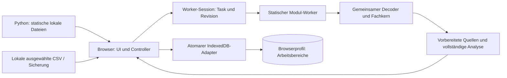

# Architektur und Projektkarte

Stand: 2026-10-18. Die aktive Anwendung läuft im Browser am festen Loopback-
Origin `http://127.0.0.1:8765`. Python liefert lokale, ausdrücklich erlaubte
Anwendungsdateien mit seiner Standardbibliothek. CSV-Import, Aufbereitung,
Fachanalyse und IndexedDB-Speicherung bleiben im Browser. Der Server besitzt
keine Workspace-Datenbank, Uploadschnittstelle oder Backend-Daten-API.

## Lager-Rundgang

`warehouse-walk.js` bietet eine getrennte, nur lesende First-Person-Ansicht. Getter liefern Lagerplan, exakte Artikelzuordnungen, vorhandene Analyse und optional den bestehenden Periodenvergleich. Nur das vertikale Sichtfeld (45 bis 100 Grad, Standard 60) wird als lokale Workspace-Darstellungseinstellung gespeichert; Geometrie und Artikeldaten bleiben unverändert. Die gemeinsame Geometrie aus `warehouse-scene.js` speist `warehouse-walk-model.js` (Meterkoordinaten, räumliche Kollisions-/Strahlabfragen und Perspektivmathematik) sowie `warehouse-walk-renderer.js` (typisierte GPU-Puffer und Kameramatrizen). Editor und bisheriger orthografischer Renderer bleiben getrennt. Gehen mit Sprung/Schwerkraft und Ducken sowie Freiflug ohne Kollisionen verwenden dieselbe Kamera; präzise Geschwindigkeiten, Bewegungsmodus, Auswahl, Kameraposition und Blickrichtung sind flüchtig; Fokusverlust, ausgeblendeter Tab und Menüwechsel stoppen die Bewegung. Die Laufzeit- und ZIP-Dateilisten enthalten die neuen Module und das Stylesheet. Bedienung und Datengrenzen: [Lager-Rundgang](warehouse-walk.md).

## Aktuelle Modulgrenzen

| Dateien | Verantwortung |
| --- | --- |
| `index.html`, `app.css`, `terminal-theme.css` | Anwendungshülle und lokale Stile |
| `app.js` | Deutsch/englische UI, Navigation, Importsteuerung, Ansichten, Workerkoordination und Workspace-Lifecycle |
| `src/application/workspace-preparation.js` | Direkt exportierte Dekodier-/Profil-, Workspace-Vorbereitungs-, Neuanalyse- und Restore-Vorgänge; benutzt dieselben Fachmodule wie der Controller-Fallback |
| `src/application/worker-session.js` | Ein sequentieller Hintergrundtask, Workerwiederverwendung, Task-ID, Revisionsprüfung, Fortschritt, Abbruch, Timeout und Leerlauffreigabe |
| `src/application/import-profile-batch.js` | Reine Vorschau-/Anwendungsplanung für ausgewählte Import-IDs; bestehende Profilprüfung, Quelltypgrenze und Erkennung veralteter Vorschauen |
| `src/ui/import-profile-panel.js` | Deutsch/englische Profilübersicht mit Filtern, Mehrfachauswahl, 50 Dateien je Seite, Vorschau und expliziter Anwendung; keine eigene Speicherlogik |
| `src/workers/workspace-worker.mjs` | Statischer lokaler Modul-Worker; importiert die vorhandenen Fachmodule und startet den gemeinsamen Taskhandler |
| `src/ui/shared/windowed-dom.js` | Begrenzte Wiederverwendung sichtbarer Tabellenzeilen und geordneter DOM-Abgleich mit Fokusbehandlung |
| `runtime.js` | Loopback-Erkennung, Startgrenzen und optionale Browserfähigkeiten |
| `encoding.js`, `csv.js` | Decoder, Streaming-CSV, Mapping, Regeln, Profile, Validierung, Artikelregister und vollständige exakte Analyse |
| `periods.js`, `terminal.js` | Abdeckung und Periodenvergleich; begrenzter Datumsindex; Analyseschreibtisch, Ranglisten und Locale-Suchprojektionen |
| `workspace.js`, `storage.js` | Workspace-/Sicherungsvertrag, Validierung/Migration, stapelsichere Base64-Prüfung und atomare Chunk-Speicherung in IndexedDB |
| `warehouse.js` | Layout-Schema 6: Struktur, Zonen, Locations, Gruppen, Endpunktverbindungen und Fahrwege; Migration, stabile IDs, gemeinsame Bauteilgeometrie und Kollisionsprüfung mit Höhen |
| `warehouse-scene.js`, `warehouse-webgl.js` | Gemeinsame Szene, CPU-Projektion, Framepuffer und lokales WebGL2-Rendering |
| `warehouse-walk-model.js`, `warehouse-walk-renderer.js` | Perspektivische Kamera, Metergeometrie, räumliche Kollisions-/Strahlabfragen und statische GPU-Puffer |
| `warehouse-walk.js`, `warehouse-walk.css` | Nur lesender Lager-Rundgang, Eingaben, Minikarte, Stellplatzdetails und vorhandene Analyseverknüpfungen |
| `warehouse-editor.js`, `warehouse-editor.css` | Layoutbearbeitung, bestätigtes Speichern, Sperren, 20-stufige Undo/Redo-Historie und Draufsicht/3D |
| `warehouse-analysis.js` | Lesende Stellplatz-/Artikelstammanalyse; verändert keine gespeicherten Layouts |
| `Start-OpenSlotting-Localhost.py` | Statischer Loopback-Dienst, Launcheridentität und begrenzter Cache erlaubter Runtime-Assets mit ETag-Revalidierung |
| `OpenSlotting.Windows.psm1` | Edge-Erkennung und sichere verwaltete Verknüpfungen |
| `OpenSlotting.Localhost.Windows.psm1` | Python-Erkennung, geprüfte Serverownership, Start/Stop und Localhost-Verknüpfungen |

Die neuen Anwendungsmodule bilden eine erste gezielte Trennung von `app.js`.
Die übrigen Fachmodule liegen weiterhin an ihren bekannten Orten. Es gibt
keinen Bundler, Framework-Build oder vollständigen Dateiumzug.

## Verarbeitungs- und Speicherweg

Der Worker profiliert Dateien, bereitet Arbeitsbereiche vor, führt Neuanalysen
aus und validiert/serialisiert Sicherungen. Er verwendet die vorhandenen
Fachkerne und gibt deren vollständige Ergebnisse zurück. Der Controller nutzt
eine bereits berechnete Analyse, statt sie nach Workerabschluss noch einmal
vollständig zu bilden. Browser ohne verfügbare Worker behalten den lokalen
Fallback über dieselben exportierten Funktionen.

Eine Session hält höchstens einen Task. Task-ID und Eingaberevision verhindern,
dass eine verspätete Antwort einen neueren Vorgang abschließt. Erfolg erlaubt
Wiederverwendung; 30 Sekunden Leerlauf geben den Worker frei. Abbruch, Fehler,
Verlassen der Seite und fünf Minuten ohne Antwort beenden ihn. Workspace-/Sprach-
und Dateiauswahlwechsel werden zusätzlich am Anwendungsvorgang geprüft.
Die Session ersetzt keine Speichertransaktion: Erst deren Bestätigung stellt
einen erfolgreichen Commit dar.

Bei geeigneten Ladevorgängen werden ArrayBuffer übertragen und anschließend
zurückgegeben. Profilierung und Neuanalyse erzeugen vorher eine Kopie der
Quellbuffer, damit Abbruch oder ein Workerfehler die weiterhin sichtbaren
Originalquellen nicht durch Transfer entziehen. Diese Schutzkopie hat Kosten;
die Architektur behauptet keine durchgehend kopierfreie Importstrecke.
Vollständig dekodierter Text und geparste Rohzeilen werden nach Vorbereitung
nicht als zweite dauerhafte Quelle gehalten. Originalbytes bleiben erhalten.

## Verträge für Analyse und Caches

| Cache / Optimierung | Eingabe und Lebensdauer | Unveränderter Fachvertrag |
| --- | --- | --- |
| Periodenindex | Private WeakMap am Zeilenarray; ausdrückliche `indexRevision`; neue Revision/Länge oder Invalidierung ersetzt den Index | Originalpositionen und vollständiger Kern; Mengen als BigInt, genaue Umsätze, Readiness, Register, Distinct-Metriken und Überschneidungen |
| Terminal-Suchtexte | Private WeakMap an Entitätsobjekten; aktuelle `label`-/`secondary`-Werte und Sprache prüfen | Trim + Locale-Lowercase + Substring; vorhandene Rang-/Ein-Abfrage-Viewcaches und zusammengesetzte Auftragsidentität |
| Sichtbare Tabellenzeilen | Nur aktuelles Fenster; Quellen-/Ansichtsidentität sowie Sprache, Spalten, Regeln und Ergebnisversion in der Darstellungssignatur | Gleiche Zellwerte, Originalquellen, Reihenfolge, Pagination und Virtualisierung |
| Lagergeometrie | Vorberechnung je Kollisionsprüfung bzw. innerhalb eines Renderframes | Gleiche SAT-Arithmetik, 0,001-mm-Kontaktgrenze, Paarreihenfolge, Picking und Float32-Ausgabe |
| HTTP-Assets | Ausschließlich erlaubte Runtime-Dateien; Dateistatistik invalidiert den Cache, Inhalt bestimmt ETag | HTML `no-store`; sonst Revalidierung mit `no-cache`/304; keine Workspace- oder Nutzerdateien im Servercache |

Der Periodenindex beginnt erst ab dem zweiten ausdrücklich revisionierten
Vergleich, bei 512 bis 250.000 Zeilen und höchstens 4.096 Datumsschlüsseln.
Mehr als 50 % ausgewählte Kandidaten nutzen den Scan. Der Index hält flache
Zeilenreferenzen/Offsets statt Zeilensnapshots oder Entitätssichten. Bei
Änderungen von Lieferdatum oder Zeilenreihenfolge am selben Array muss der
Aufrufer eine neue Revision setzen oder `invalidateComparisonIndex` verwenden;
die Anwendung erzeugt neue Analyseergebnisse. Mengen, Namen und Registrywerte
werden durch den Index nicht zwischengespeichert.

Fehlendes Lieferdatum gehört zu keinem gewählten Zeitraum. Fehlende Exporttage
belegen weiterhin keinen Nullbedarf. Distinct-Kunden-/Auftragszahlen sind
nicht additiv; Prefixsummen eines engen Labor-Mengenkerns ersetzen deshalb
keine vollständige Analyse. Lagergrenzen bleiben 150 Objekte und 5.000
Stellplätze. Editorhistorie, Sperren, Codes und bestätigtes Speichern behalten
ihre bestehenden Regeln.

## Datenschutz, Laufzeit und Datenkompatibilität

IndexedDB bleibt im aktuellen Browserprofil und Origin: Datenbank
`openslotting-workspaces`, Datenbankversion 3, Workspace-Schema 21. Neue
Module und flüchtige Caches erfordern keine Datenmigration und verändern den
Sicherungsvertrag nicht. Originalbytes und BigInt-/Binärkodierung bleiben
verlustlos. Die Base64-Korrektur vermeidet die rekursiv gruppierte Prüfung
großer Sicherungen bei gleichem akzeptiertem Format.

Die normalen Benutzerbefehle heißen `Start-OpenSlotting.cmd`,
`Stop-OpenSlotting.cmd`, `Install-OpenSlotting.cmd` und `Remove-OpenSlotting.cmd`.
Vorhandene `*-Localhost`-Namen bleiben kompatible Einstiegspunkte mit demselben
Server und Datenorigin. Python 3.8 oder neuer bleibt die einzige zusätzliche
Nutzerabhängigkeit. Vorhandener Browser, Windows-PowerShell und der vollständige
lokale Ordner genügen; keine npm-/pip-Pakete, OpenSlotting-EXE oder Cloudkonten.
Node.js ist nur ein Entwicklungswerkzeug.

[Runtime](runtime.md), [Start](localhost-start.md), [Datenvertrag](data-format.md),
[Workspace-Vertrag](workspace-format.md) und [Portable-Pause](portable-mode-paused.md)
beschreiben diese Grenzen. Portable bleibt am dokumentierten Stand pausiert;
Interessenten können dort eigenständig weiterarbeiten. Der aktive Baum pflegt
eine Localhost-Anwendung.

## Entwicklung, Auslieferung und Nachweise

- `tests/`: Fach-/Integrationsregressionen und Windows-Launcherprüfungen.
- `test-data/`: synthetische CSV-Quellen.
- `tools/benchmark-*.cjs`: optionale synthetische Entwicklungsvergleiche.
- `tools/package-release.ps1`: ZIP aus einem expliziten Git-Commit und einer
  festgelegten Dateiliste; neue Runtime-Module müssen hier und in der
  Python-Freigabe vorhanden sein.
- `.github/workflows/ci.yml`: Syntax, Tests, Launcherprüfungen und Paketierung.
- [Produktionsleistung](performance/README.md): Funktionsmatrix, ausgewählte
  Ansätze, Messungen und bewusst nicht übernommene Alternativen.
- [Workspace/UI](performance/workspace-ui.md): separater Nachweis für Worker,
  UI-Wiederverwendung, Base64 und statische HTTP-Caches.
- `dist/`, `__pycache__/`: ignorierte erzeugte Dateien, keine Nutzerdatenablage.

Node-/Logikparität, nachgebildete DOM-Tests, Browsersteuerung und nativer
Edge-Start sind unterschiedliche Nachweise. Der genaue Kandidat auf dem
Firmen-PC in Edge benötigt weiterhin die eigene vollständige Bedien- und
Geräteabnahme; eine CPU-Messung bestätigt keine GPU-FPS oder Benutzerarbeitszeit.
Aktuelle Prüflisten stehen in [Localhost-Abnahme](acceptance-localhost.md) und
[Release-Checkliste](release-checklist.md).

## Zielstruktur und historische Labore

Der [Strukturplan](project-structure-plan.md) unterscheidet bereits ergänzte
Produktionsmodule von späteren Umzügen. Fach-/UI-/Persistenzgrenzen können
schrittweise weiter herausgelöst werden, ohne Datenformate gleichzeitig zu
ändern. Neue Funktionen brauchen einen klaren Fachvertrag statt vorsorglicher
Frameworks oder eines Python-Datenbackends.

Das [Localhost-Labor](../experiments/localhost-lab/README.md) und das
[Feature-Labor](../experiments/feature-lab/README.md) bewahren frühere Varianten
und Ergebnisse. Sie enthalten unter anderem alternative Speicher, Kompression,
Import-/Exportsinks, Spalteninterpretation, mathematische Vollindizes,
Editorhistorie und UI-Entwürfe. Diese Dateien werden weder von der Anwendung
geladen noch durch den Python-Produktserver ausgeliefert oder ins ZIP gepackt.
Nur die in der aktuellen Funktionsmatrix benannten Produktionsänderungen sind
integriert; historische Laborzahlen werden nicht als heutige Produktabnahme
ausgegeben.

## Lagerübernahme vom 2026-10-09

Workspace-Schema 14 migriert Layout-Schema 1 zu 2. Die gemeinsame Worker-
Vorbereitung ruft weiterhin den zentralen Migrator auf; Originalbytes, Quellen-
bezüge und exakte Fachanalyse bleiben erhalten. SQLite, OPFS oder Backend-Daten-
API werden dafür nicht eingeführt. Die neue Zonen-/Location-Verknüpfung ist
Metadatenzustand; Indexmaps werden einmal pro Zeichenvorgang abgeleitet und nicht
gespeichert. Die lesende 3D-Auswertung verändert keine Zonen, Codes oder Geometrie.
Die vorbereitete SAT-Prüfung und direkten Float32-Puffer bleiben erhalten.

Siehe [Lagerübernahme und neue Messungen](performance/warehouse-layout-v2.md).

## Lagereditor-Fortschreibung vom 2026-10-10

Der gemeinsame Migrator überführt Layout 1/2/3/4/5 nach Layout 6 und Workspace 20.
Stellplätze speichern rechteckige Flächen in lokalen Millimeterkoordinaten je
Ebene (maximal zehn). Neue Plätze liegen nebeneinander an der Regalfront und
nutzen die gesamte Fachtiefe. Alte gleichmäßige Teilungen erhalten explizite Flächen;
IDs und Codes bleiben erhalten. Editor und Auswertung nutzen dieselbe Geometrie.
Gruppen und Endpunktverbindungen sind eigene Metadatenlisten. Durchfahrten
verweisen optional auf einen Fahrweg; Fahrzeugmaße werden ausdrücklich erfasst.
Bestehende gezeichnete Fahrwege behalten lokale Punkte und eine separate Breite.
Neue Wand- und Fahrwegrezepte speichern `junction.shape` und eigene Armlängen.
Ein mittleres Quadrat und rechteckige Arme bestimmen die tatsächliche Form;
Darstellung, Picking und Kollisionsprüfung verwenden diese Teile. Zwei, drei
oder vier stabile Anschlüsse werden in die Weltkoordinaten transformiert.
Magnet und Verbinden berücksichtigen Objektfamilie, Breite, Anschlussrichtung
und belegte Anschlüsse. Der Editor bietet keine Freihand-Wegpunkte mehr an.
`createDistanceConnection` erzeugt aus zwei freien Anschlüssen eine Kette normaler
Geraden und Eckrezepte mit Endpunktverbindungen. Bestehende Objekte bleiben
bei der Erzeugung stehen. Eine begrenzte Suche vergleicht bis zu 128 orthogonale
Verläufe; normalisierte Bauteile werden gegen Hindernisse und nicht benachbarte
eigene Teile geprüft. Ein Cache für Hindernisteile lebt nur in diesem Aufruf.
Fahrzeugmaße können direkt bei der Verbindung eingegeben werden; bekannte Maße
der Endobjekte und deren größte Reserven bilden die Mindestanforderungen für
neue Stücke. Endobjekte bleiben unverändert. Ohne Fahrzeughöhe werden weiterhin
Bauteile geprüft, die die Fahrwegunterkante schneiden; die Überbauhöhe bleibt
ungeprüft und die Vorschau kennzeichnet fehlende Maße. Mit Höhe prüft derselbe
Bauteilpfad den vollständigen Höhenraum einschließlich Reserve. Die lichte
Regalhöhe wird nicht als Fahrzeughöhe angenommen. Fehlversuche können ein
konkretes Hindernis und dessen lichte Höhe nennen. Die Vorschau nutzt den bestehenden
Revisions-, Sperr- und Undo-Pfad; ein neuer Speichervertrag ist nicht erforderlich.
Wandöffnungen bestehen aus verbunden modellierbaren Wandteilen, einem
Öffnungsobjekt und gegebenenfalls einem erhöhten Sturz.

`warehouse.js::physicalParts` beschreibt dieselben Bauteile für Szene und
Kollisionsprüfung. Die bestehende SAT-/Sweep-Vorprüfung begrenzt Objektpaare;
anschließend werden tatsächliche Teile und Höhen untersucht. Ein flüchtiger
Bauteilcache mit Höhenbändern wird nur innerhalb einer Prüfung aufgebaut.
Fahrwege werden segmentweise einschließlich ihrer Verbindungsflächen geprüft.
Marker und Artikelzuordnungen verändern keine physische Geometrie.

`warehouse-scene.js::buildBoxes` akzeptiert optional `colorMode: 'structure'`.
Der Editor verwendet damit in Struktur/3D blaue Palettenregalrahmen, orange
Traversen und graue Fachböden; die Legende folgt dem Arbeitsmodus und der Ansicht.
Die schreibgeschützte Analyse verwendet dieselbe Bauteilpalette standardmäßig
und bietet einen sitzungslokalen Umschalter auf Nutzungsfarben. Ihre Legende folgt
dieser Auswahl; Artikel- und Stellplatzmarker behalten ihre Zuordnungsfarben.
Ohne die Struktur-Option bleiben die Nutzungsfarben maßgeblich. Bauteilreferenzen, Picking und Geometrie sind vom
Darstellungsmodus unabhängig; die Palette ist kein gespeichertes Layoutmerkmal.

Der WebGL-Renderer zeichnet Fahrwegmarkierungen als transparente Oberflächen.
Eine Stencil-Maske verhindert mehrfaches Einfärben derselben sichtbaren Samples
bei überlappenden Objekten, Kreuzungsarmen und alten Wegsegmenten. Die
Tiefenprüfung erhält die Verdeckung durch Regalteile. Der getrennte ID-Pass
verwendet weiterhin die vollständigen Körper und ihre bisherigen Referenzen.
Andere Flächenarten behalten ihre eigene Transparenz. Ohne Stencil-Puffer
steht die Draufsicht weiterhin zur Verfügung. Dort werden alle Wegrechtecke
mit gleicher Umlaufrichtung in einem gemeinsamen Pfad einmal gefüllt;
Beschriftungen, Konturen und Auswahl bleiben objektbezogen. Speicherformat
und Kollisionsgeometrie werden durch diese Darstellung nicht geändert.

Der Editor erzeugt Vorschaukandidaten und zeigt Auswirkungen vor dem Speichern.
Der vorhandene Revisions-/Transaktionspfad, aktuelle Sperren, Fehlerbehandlung
und vollständige Undo/Redo-Snapshots bleiben maßgeblich. Die Analyse liest
weiterhin nur das gespeicherte Layout. Neue Backend-APIs, Bibliotheken,
Installationen oder Runtime-Dateien sind nicht erforderlich. Der historische
Nachweis vom 09.10. deckt diese neuen Funktionen und deren Leistung nicht ab.

## Editor-Navigation vom 2026-10-10

Der Editor behandelt Mausradereignisse zentral am vorhandenen Root-Element.
Die Zeichenfläche zoomt; Zahlen- und Auswahlfelder leiten Scrollbewegungen an
ihren nächsten scrollbar verfügbaren Editorbereich, ohne Feldwerte zu ändern.
Strg-/Meta-Gesten bleiben beim Browser. Zoomereignisse verwenden ihre Einheit
und Bewegungsgröße; das Zeichnen wird über `requestAnimationFrame` gebündelt.

Vor dem DOM-Neuaufbau werden Scrollpositionen, Fokus, Textauswahl, offene
Werkzeugabschnitte und ausgewählte Eingabeentwürfe erfasst und im passenden
Workspace-/Objekt-/Bereichskontext wiederhergestellt. Fenster- und
Root-Größenänderungen lösen eine gebündelte Neuzeichnung aus. Die Arbeitshöhe
wird im dauerhaften Workspace-Rahmen per Flex-/Grid-Layout verteilt. Der frühere
bildschirmfüllende Maximierungsmodus mit gesperrtem Hintergrund ist entfernt.
Diese UI-Zustände werden nicht gespeichert; Backend, Abhängigkeiten und
Datenvertrag bleiben unverändert.

## Dauerhafter Workspace-Rahmen

`terminal-theme.css` begrenzt die Anwendung auf die dynamische Viewport-Höhe.
Banner und kompakter Datenschutz-/Versionsfuß erhalten eigene Grid-Zeilen;
Navigation und abgerundeter Workspace teilen die verbleibende Fläche. Es gibt
keine äußere Dokument-Scrollfläche. `.app-page` ist die fokussierbare interne
Scrollregion für lange Formulare, Tabellen und Detailansichten. Unter 761 px
wird die Navigation als horizontaler Streifen angeordnet; ihre bisherigen
Aktionen bleiben erhalten. Workspace-Auswahl verwendet denselben Rahmen.

Die schmale Navigation verwendet eigene kurze DE-/EN-Beschriftungen, während
Seitentitel und Menübeschreibungen ihre vollständigen Namen behalten.
`data-i18n-title` und `data-i18n-aria-label` aktualisieren Tooltip und zugänglichen
Buttonnamen beim Sprachwechsel. Text darf innerhalb der Buttonbreite umbrechen;
die vertikale Navigationsleiste erzeugt keinen horizontalen Überlauf. Vertikales
Scrollen in niedrigen Fenstern und der horizontale mobile Streifen bleiben
für den Zugang zu allen Aktionen verfügbar.

`app.js` aktualisiert gemessene Rahmengrenzen nach Navigation und Änderungen
der Banner-, Footer- oder Workspace-Größe über einen gebündelten
`ResizeObserver`-Pfad. Der Quellspalten-Drawer und sein Hintergrund bleiben
innerhalb dieser Grenzen. Aktionen, die bisher das Fenster an den Anfang
scrollten, scrollen nun die aktive interne Seite. Vorhandene Quellen-/Detail-
Sprünge bleiben erhalten. Editor und 3D-Analyse zeichnen nach Größenänderungen
mit den tatsächlichen Canvas-Abmessungen. Unter 1001 px stapeln die 3D-Ansichten
ihre Bereiche mit interner Scrollmöglichkeit. Es werden keine zusätzlichen
Bibliotheken geladen und keine Workspace-Metadaten ergänzt. Visuelle Edge-
Abnahme bei verschiedenen Fenstergrößen und Browser-Zoomstufen steht noch aus.

Bodenebenen sind pro Fach standardmäßig aktiv (bei Durchfahrten aus). Sie
verwenden eigene stabile IDs und `levelIndex: -1`, ohne höhere Ebenen umzunummerieren.
Die Bedienseite liegt an der positiven Z-Kante; Richtungsmarkierungen werden aus derselben
Rotation wie die Regalgeometrie abgeleitet und sind keine Kollisionskörper.

Stellplatzmarkierungen besitzen eigene gebündelte Zeichen- und Picking-Puffer.
Die sichtbaren Rahmen sind nur optisch eingerückt; der ID-Pass nutzt weiterhin
alle Flächen in Originalgröße. Positionsziffern werden bei ausreichendem Zoom
als Linien erzeugt. Nur die Auswahl erhält eine schwache Flächentönung. Fachböden
bleiben als physische Bauteile grau. Sichtbarkeit und Farbdarstellung sind reine
Sitzungszustände und ändern weder Workspace-Schema 21 noch Layout-Schema 6.
