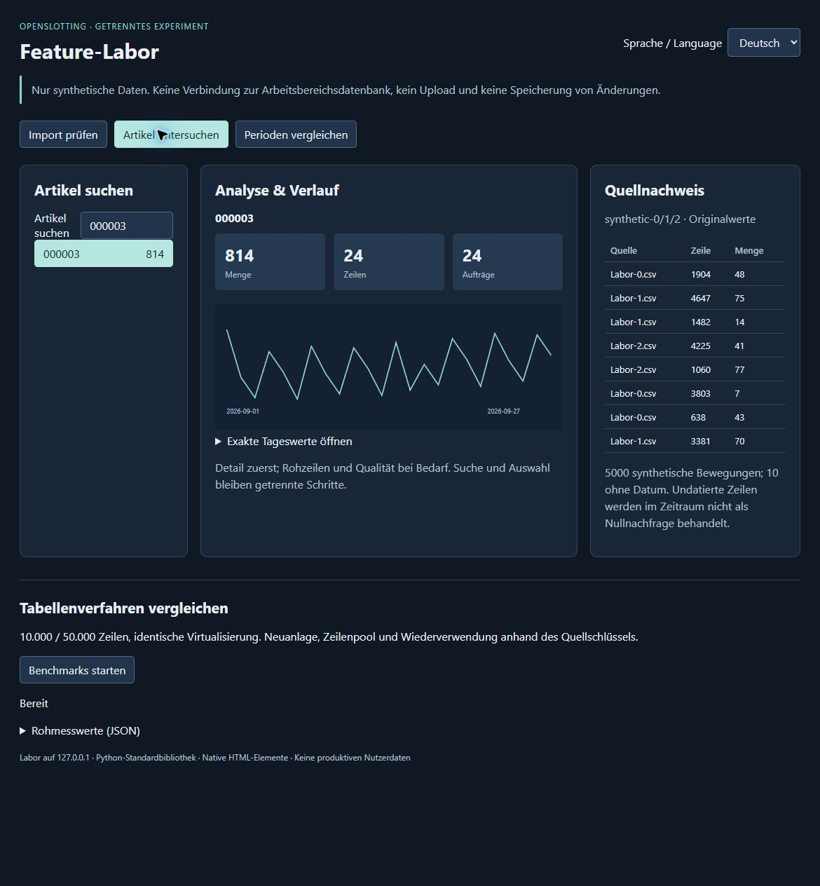

# UI-Verfahren und veraltete Berechnungsergebnisse

Stand: 2026-10-04. Getrenntes Labor, **keine Produktintegration**.
Die [Anleitung](../README.md) beschreibt den eigenen Python-Server.

## Echte Edge-Messung

Drei vollständige Läufe in Microsoft Edge 154 auf Windows. Kein anderer
Agent-Benchmark lief während der finalen Edge-Läufe. Hintergrundlast des
Rechners war nicht kontrolliert. Ein Aufwärmlauf plus fünf rotierte Samples
je Variante, Datensatz und Aufgabe. Mediane in Millisekunden pro **80 Updates**.
Eine Tabellenkörper-Geometrielesung erzwingt synchrones Layout; die tatsächliche
Scrollposition wird gesetzt. Erstaufbau und Datenerzeugung liegen außerhalb
der Folgemessung, Erstaufbauzeiten sind gesondert im JSON.

Referenz ist das **nachgebildete aktuelle Fragment-/replaceChildren-Muster**
aus `app.js:5009`, mit dem unveränderten `terminal.visibleLineWindow`:
480 px Höhe, 32 px pro Zeile, Overscan 8, sieben gleiche Spalten. Alle Varianten
haben denselben verbesserten Guard für Spaltenidentität, Sprache und Revision
sowie denselben Fokusvertrag. Dies ist keine exakte Voll-App-Baseline.
Die bestehende Anwendung virtualisiert und überspringt gleiche Fenster bereits.

| Variante | Prinzip | Aufwand |
| --- | --- | --- |
| Fragment | sichtbare Datenzeilen neu erzeugen | einfache Lebensdauer, DOM-Allokationen |
| Zeilenpool | DOM-Zeilen nach sichtbarem Offset wiederbefüllen | wenig neue Zeilen, aber sämtliche neuen Feldwerte aktualisieren |
| Quellschlüssel | vorhandene Zeile anhand `[source_file_id, source_line]` wiederverwenden | Map und geordnete DOM-Änderungen, Vorteil bei überlappenden Fenstern |

Caches bleiben auf das sichtbare Fenster begrenzt. Spacer werden in allen
Varianten erstellt. Aktive Buttons behalten die Identität ihrer Quellzeile;
wird sie aus dem Fenster entfernt, geht der Fokus an den Tabellenbereich.
Recycelte Buttons erhalten neue Datenattribute und lokalisierte Labels.
Delegierte Benutzeraktionen können deshalb den aktuellen Artikel lesen.

### Dritter Lauf am endgültigen Modulstand

| Quelldaten | Aufgabe | Fragment | Pool | Quellschlüssel |
| ---: | --- | ---: | ---: | ---: |
| 10.000 | überlappendes Scrollen | 315,40 | 336,20 | 153,20 |
| 10.000 | große Sprünge | 306,20 | 342,80 | 314,10 |
| 10.000 | gleiches Fenster | 0,20 | 0,20 | 0,20 |
| 50.000 | überlappendes Scrollen | 299,70 | 338,10 | 159,50 |
| 50.000 | große Sprünge | 301,80 | 332,80 | 284,80 |
| 50.000 | gleiches Fenster | 0,20 | 0,20 | 0,20 |

Der erste Lauf bestätigt die Richtung bei überlappendem Scrollen: 50.000 Zeilen
311,40 / 350,30 / 147,50 ms. Bei großen Sprüngen ist Quellschlüssel-Wiederverwendung
im ersten Lauf sogar langsamer (332,50 statt 304,60 ms). Die Streuung verhindert
eine pauschale Empfehlung für alle Scrollmuster. Der Pool reduziert Allokationen,
ist aber beim überlappenden Scrollen in allen Läufen langsamer. Weniger
DOM-Erzeugung allein beweist keine geringere Layout-/Updatezeit.

Erstaufbau liegt für die Varianten im Bereich weniger Millisekunden, ohne
klaren Sieger. Der Datensatz mit 50.000 Zeilen erzeugt nicht 50.000 DOM-Zeilen;
gerendert wird jeweils nur die gleiche Sichtmenge. Die gleichen-Fenster-Werte
liegen nahe der Timerauflösung und stellen keinen messbaren Zusatzgewinn über
den vorhandenen Guard dar. Keine FPS-, Paint-, GPU- oder Browser-Speicheraussage.

Rohsamples, erzeugte Datenzeilen und Erstaufbau:
[Lauf 1](results/edge-ui-run-1.json), [Lauf 2](results/edge-ui-run-2.json),
[finaler Lauf 3](results/edge-ui-run-3.json) und seine
[exakten Quellhashes](results/final-run-sources.json).
Alle enthalten erfolgreiche komplette Zell-/Quellschlüsselvergleiche sowie
Fokus-, Spalten-/Revisionswechsel-, Textschutz- und Leereingabeprüfungen für
alle drei Renderer. Fixtureaufbau, Filter-/Sortierzeit und Worker/Persistenz
gehören nicht zu dieser DOM-Messung.

## Drei bedienbare UI-Ansichten

| Ansicht | Nutzen | Trade-off / Bewertung |
| --- | --- | --- |
| Importprüfung | Originalwerte, physische Positionen, Doppelheader und erklärbare Vorschläge nebeneinander; ausdrückliche Bestätigung | breiter Arbeitsbereich, bei vielen Zielfeldern lange Seite; später progressive Pflicht-/Zusatzfelder prüfen |
| Artikelansicht | Suche → Auswahl → kompakte Werte/Verlauf → Quelle; exakte Tageswerte aufklappbar | bekannte progressive Idee im aktuellen Projekt, hier als eigenständige native UI; Filter und Auswahl klar beschriften |
| Periodenvergleich | Zeitraum, exakte Differenz, gültig datierte Zeilen und unbekannte Daten zusammen | UI-Vorschau berechnet nur Mengen/Zeilen, keine komplette ABC-/Umsatz-/Readiness-Analyse |

Import nutzt die echte synthetische Doppelheader-Fixture aus dem IO-Labor und
deren gespeicherte Modulvorschläge. Artikel-/Periodenansichten teilen 5.000
synthetische Bewegungen, 211 Artikel und zehn unbekannte Lieferdaten. Es sind
zwei explizite Beispielsätze, kein neuer zusammenhängender Importworkflow.
Die native Laborbestätigung blockiert Mehrfachbelegung einer Quellposition;
sonstige Fachvalidierung bliebe beim tatsächlichen Importkernel.

Sprache DE/EN, Suchtext, ausgewählter Artikel und Mappingentwurf bleiben bei
Sprach-/Ansichtswechsel erhalten. Mappingänderungen heben die Bestätigung auf.
Periodenfelder sind eine eigene flüchtige Vorschau. Tastaturauswahl behält
Fokus. Leere Treffer, ungültiger Datumsbereich und unbekannte Tage sind sichtbar.
Texte werden über `textContent` ausgegeben; kein CSV-Inhalt wird als HTML benutzt.

Die Diagrammkoordinaten nutzen BigInt-Differenzen und beschränkte rationale
Pixelverhältnisse. Erst der auf 120.000 begrenzte Pixelzähler wird zu Number.
Bruchteile und Vorzeichen bleiben erhalten; extrem große Mengentexte werden
nicht zuerst in einen ungenauen Number umgewandelt. Der Pixelplot ist dennoch
eine visuelle Rundung; genaue Werte stehen in der Tabelle.

### Sichtbare Prüfung

[edge-ui-checks.json](results/edge-ui-checks.json): acht erfolgreiche Abläufe
mit echten Browseraktionen und anschließender DOM-/Accessibility-Beobachtung:
Mappingkonflikt, Sprachwechsel mit Entwurf, leere Suche, Enter-Auswahl mit
führenden Nullen/Fokus, Artikel-/Suchzustand über Sprache, ungültiges Datum,
Überlappung/Unknown-Date und Mapping über Ansichten. Keine Warn-/Fehlerlogs im
abschließend beobachteten Tab. Zusätzlich zwölf Node-Tests für Tabellenmodell,
TaskGate und Gleichheit der sichtbaren generierten Engine-Fixture. Keine
behauptete Benutzerstudie oder vollständige WCAG-Abnahme.



Weitere Bilder: [Import](results/import-review.jpg),
[Perioden](results/period-comparison.jpg),
[abgeschlossener Vergleich](results/benchmark-complete.jpg).

Native Controls/Tabellen besitzen ihre normale Tastatursemantik. Ein eigener
interaktiver ARIA-Grid braucht zusätzlich definierte Fokus-/Pfeiltastenregeln.
[Offizielles Grid Pattern](https://www.w3.org/WAI/ARIA/apg/patterns/grid/).

## TaskGate als separates Steuerungsmodul

`shared/task-gate.mjs` behandelt nur Read-/Compute-Ergebnisse:

```text
Kontext = Workspace + Datenrevision + Sprache + Ansicht + Requestschlüssel
neuer Kontext / neue Aufgabe / cancel → AbortSignal + Serienwechsel
nach await → nur aktuellen Kontext synchron in die UI übernehmen
```

Auch ein Worker, der Abbruch ignoriert, darf sein altes Ergebnis nicht anwenden.
Aktuelle Fehler werden nicht versteckt; veraltete Fehler werden verworfen.
Asynchrone `apply`-Callbacks werden abgewiesen; Promise-Rückgabe verletzt den
Vertrag. `apply` darf keine spätere ungeschützte Speicherung starten. Abbruch
macht bereits erfolgte Nebenwirkungen nicht rückgängig. Das Modul schützt keine
IndexedDB-Transaktion, Autosave, Importregistrierung oder Dateischreiboperation.

Sechs Tests prüfen alle Kontextdimensionen, Supersession, expliziten Abbruch,
gleichbleibenden Kontext sowie aktuelle/veraltete Fehler und Async-Apply.
**TaskGate ist weder in der Labor-UI noch im Produkt eingebunden.** Ein neuer
Filter muss neue Aufgabe/Requestschlüssel auslösen; eine unveränderte Ansicht
allein ist keine ausreichende Gültigkeit. Es gibt keinen Performance-Claim
aus dieser Korrektheitsprüfung.

## Entscheidung

Quellschlüssel-Wiederverwendung ist der aussichtsreichste Tabellenkandidat für
überlappendes Scrollen. Im echten Controller wären Spaltenänderung, Fokus,
unterschiedliche Zellinhalte/Höhen und Cache-Lebensdauer gemeinsam zu prüfen.
Ein adaptiver Wechsel zwischen Fragment und keyed ist erst ein weiterer
Entwurf. Der Pool erhält keine pauschale Empfehlung. Die drei Ansichten sind
prüfbare Gestaltungsvorschläge; eine produktive UI-Auswahl und eine Prüfung
auf dem Firmen-PC mit freigegebenen Quellen stehen noch aus.
